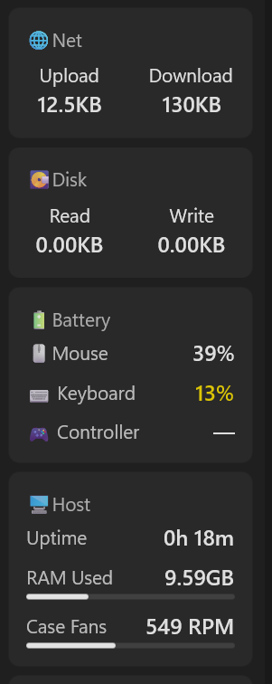
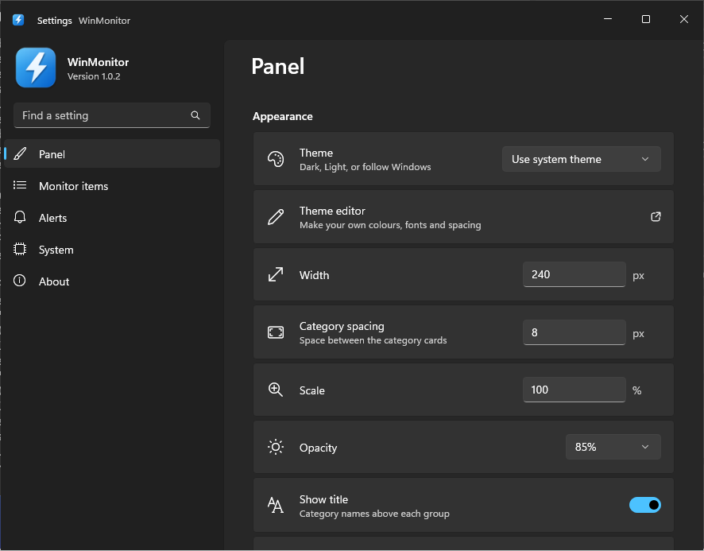
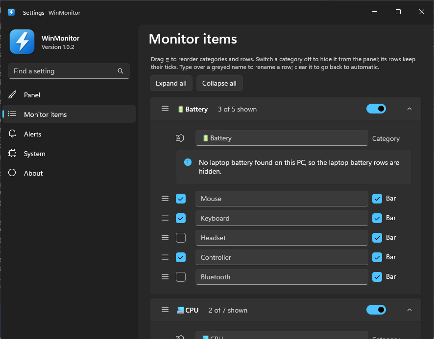
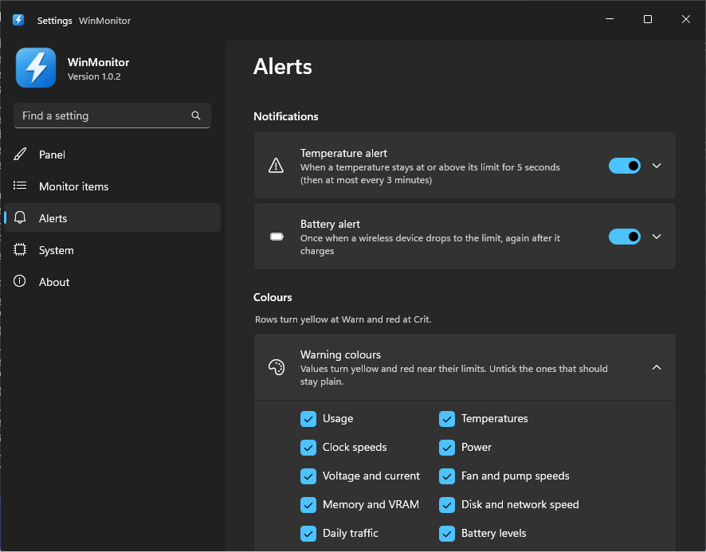

# WinMonitor

A small floating hardware monitor for Windows 11, with wireless device batteries built in.
Free and open source (MIT). Portable: unzip and run.

## Features

- CPU, GPU, memory, disks, network, motherboard, laptop battery and daily traffic
- Wireless mouse, keyboard, headset and controller batteries
- Dark, Light or custom themes; per-row bars and names
- Temperature and battery alerts
- 7-day history with CSV export
- Click-through, always on top, keep on screen

## Screenshots

<p>


</p>
<p>


</p>

## Install

1. Download `WinMonitor-portable-x64.zip` from [Releases](https://github.com/znbaboy/WinMonitor/releases).
2. Unzip anywhere and run `WinMonitor.exe` (needs administrator rights for sensors). `settings.json` is created next to it on first start.

Optional: the [PawnIO](https://github.com/namazso/PawnIO.Setup) driver for CPU temperature, clock and power. WinMonitor offers to install it.

## Use

- **Right-click** the panel or tray icon for the menu
- **Drag** to move; **double-click** for Settings

## Changes from LiteMonitor

**Added**
- Windows 11 look (WinUI 3) across the panel and every window
- Wireless device batteries (from Halo Battery): Razer, Logitech, PlayStation, Xbox and Bluetooth, with a low battery alert
- Built-in Dark and Light themes, or follow Windows
- Simpler Monitor Items page: collapsible categories, drag to reorder, rename in place, switch whole categories off
- One Battery category for laptop and wireless devices; laptop rows hidden on PCs without a battery
- History keeps hidden items that are already being read; optional min–max shading
- Separate temperature alert limit for disks
- Portable and self-contained: no installer, no .NET needed
- Lighter on memory (about 14 MB)
- Update check with one-click install, and PawnIO driver install / update, in Settings > About

**Removed**
- Taskbar mode and horizontal bar layout
- Auto-hide at screen edges
- FPS counter (PresentMon)
- Web view, plugins and non-English languages
- The 10 bundled themes (make your own in the theme editor)
- Extras: clean memory, prevent sleep, turn off display, scheduled shutdown, restart Explorer, refresh icons, clean temp files

**Changed**
- Always on top is off by default
- Double-click opens Settings
- Settings apply instantly (no OK / Cancel)

## Build

```powershell
msbuild WinMonitor.csproj /restore /t:Publish /p:Configuration=Release /p:Platform=x64 /p:RuntimeIdentifier=win-x64 /p:PublishDir=publish\WinMonitor\
```

## Credits

Based on [LiteMonitor](https://github.com/Diorser/LiteMonitor) (MIT), with [Halo Battery](https://github.com/HeyOkay/HaloBattery) (MIT), [LibreHardwareMonitor](https://github.com/LibreHardwareMonitor/LibreHardwareMonitor) (MPL-2.0), [Windows Community Toolkit](https://github.com/CommunityToolkit/Windows) (MIT) and [WinUIEx](https://github.com/dotMorten/WinUIEx) (MIT). See [THIRD-PARTY-NOTICES.txt](THIRD-PARTY-NOTICES.txt).
